# Software Design Document (SDD)

**Team name:** 383-G9  
**Version:** ☒ First version (Week 6) ☐ Final (Week 10)  
**Last updated:** 2026-10-31

---

## 1. Architecture Overview

The platform is a client–server web application with three layers: a React single-page application in the browser, an Express REST API on Node.js and a SQLite database file. React talks only to the API (HTTP requests with JSON and the user's JWT), and the API checks identity, permission and data on every request before it reads or writes the database. One backend AI module is the only part that calls the external AI provider, GitHub Models; in mock mode it returns a fixed text without a network call, so the application and its tests also work without the AI.

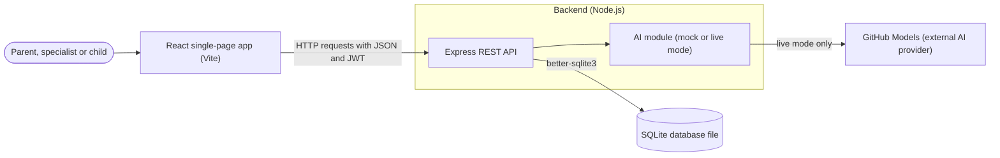

### Technology Stack

| Layer | Technology |
|---|---|
| Frontend | React 19 (`react`, `react-dom` ^19.3.1) single-page application, built and served with Vite (`vite` ^8.3.5, `@vitejs/plugin-react` ^6.1.2); in development Vite forwards `/api` to Express |
| Backend | Node.js 22 or newer, Express 5 (`express` ^5.3.0), `bcryptjs` ^3.0.3 for password hashes, `dotenv` ^18.0.9 for `server/.env`; JWT login is added with M1 |
| Database | SQLite file through `better-sqlite3` ^13.0.3; schema in `server/src/db/schema.sql`, synthetic demo data from `npm run seed` |
| Testing | Jest ^30.5.2 and Supertest ^7.3.1 (backend), Vitest ^5.0.5 with `@testing-library/react` ^16.3.3 and jsdom ^30.1.3 (frontend), Playwright ^1.64.1 (end-to-end) |
| CI | GitHub Actions (`.github/workflows/ci.yml`): on every push and pull request to `main`, Node.js 22 runs `npm ci`, `npm test`, `npm run build` and the Playwright tests with `AI_MODE=mock` |
| AI | GitHub Models chat completions API, model from `AI_MODEL` (default `openai/gpt-4o-mini`), called only by `server/src/ai/index.js`; `AI_MODE=mock` (default) or `live`, token `GITHUB_TOKEN` only in `server/.env` |

---

## 2. Module Design

Server files are under `server/src/`, client files under `client/src/`.

| Module | Main components | Implements requirements |
|---|---|---|
| M1 | React: `LoginPage`, `AuthContext` (keeps the token and the user; logout calls `POST /api/auth/logout`, then deletes them), `ProtectedRoute` (no token: login page; another role's page: access denied), `api.js` (adds the `Authorization: Bearer` header). Express: `routes/auth.js` (login checks the bcrypt hash and signs a JWT with user id, role and a random token id `jti`; `me`; logout stores the token's `jti` in `revoked_tokens`). Middleware: `requireAuth` (JWT signature and expiry, else 401; revoked tokens rejected with 401), `requireRole` (route not meant for the user's role, 403) | FR-M1-01, FR-M1-02, FR-M1-03, FR-M1-04, FR-M1-05 |
| M2 | React: `ParentDashboard` (child, linked specialists, link-by-email form, unlink with confirmation), `SpecialistChildrenPage`. Express: `routes/children.js` (children list, link, unlink). Middleware: `requireChildAccess` (loads the current parent or specialist link from `children` and `specialist_links` on every request about a child, else 403) | FR-M2-01, FR-M2-02, FR-M2-03, FR-M2-04, FR-M2-05, FR-M2-06 |
| M3 | React: `WeeklySchedulePage` (week picker, events by day and time, add-event form not shown to the child). Express: `routes/events.js` (week filter; checks title, date, start and end time) | FR-M3-01, FR-M3-02, FR-M3-03, FR-M3-04, FR-M3-05 |
| M4 | React: `TaskForm`, `ChildTasksPage` (own tasks with a "done" button), `TaskList` (status of each task for the assigner). Express: `routes/tasks.js` (`GET` and `POST /api/tasks`, `PATCH /api/tasks/:id`; a child may change only their own task) | FR-M4-01, FR-M4-02, FR-M4-03, FR-M4-04, FR-M4-05, FR-M4-06, FR-M4-07 |
| M5 | React: `EntriesPage` (newest first with author, date and "edited" mark; add and edit form for linked specialists). Express: `routes/entries.js` (only the author may edit; sets `edited` and `edited_at`; `requireRole` keeps children out) | FR-M5-01, FR-M5-02, FR-M5-03, FR-M5-04, FR-M5-05, FR-M5-06, FR-M5-07 |
| M6 | React: `DocumentsPage` (upload form, list, view and download through the API with the token). Express: `routes/documents.js` (multipart upload; type and size checked before anything is stored; files kept in `server/data/uploads/`, which is not in Git, and sent back with their original name) | FR-M6-01, FR-M6-02, FR-M6-03, FR-M6-04, FR-M6-05 |
| M7 | React: `StatisticsPage` (week picker, total rate, rate per development area, "no tasks" message). Express: `routes/statistics.js` with the pure function `completionStats(tasks)`, unit-tested with Jest | FR-M7-01, FR-M7-02, FR-M7-03 |
| M8 | React: `AiSummaryPanel` (first loads the stored summary of the week with the reader's feedback and sends the POST only when no summary exists; summary button, loading and error states, "AI-generated" label, source-record links, fixed note, helpful/incorrect buttons with the saved choice shown as selected). Express: `routes/summaries.js` (collects the week's records the reader may see, stores summaries and feedback and returns them again). AI module `ai/index.js`: prompt builder `buildMessages(role, records)` and `summarize()` with mock mode | FR-M8-01, FR-M8-02, FR-M8-03, FR-M8-04, FR-M8-05, FR-M8-06, FR-M8-07, FR-M8-08, FR-M8-09 |

Could requirements (FR-M3-05, FR-M4-06, FR-M4-07, FR-M5-07, FR-M6-05) are built only after all Must requirements pass; their design is added to this document when they are planned.

**Access control.** Every protected request passes three checks on the backend, because hiding a button in React does not stop a request sent without the form. `requireAuth` verifies the JWT signature and expiry and rejects revoked tokens, whose `jti` was stored in `revoked_tokens` at logout (401 otherwise); the token is signed but not secret, so it carries only the user id, the role and a random token id (`jti`), never a password or child records, and the signing secret is read from `server/.env`. `requireRole` then rejects routes meant for other roles (403), and `requireChildAccess` loads the current link from the database for every request about a child: the parent must own the child (`children.parent_id`), a specialist must have a row in `specialist_links`, and a child may only reach their own tasks and events (403 otherwise). Routes under `/api/children/:childId` get this check once at router level, `GET` and `POST /api/tasks` check the `childId` sent with the request (a child always gets only their own tasks), and routes with a record id (`/api/tasks/:id`, `/api/entries/:id`, `/api/documents/:id/file`, `/api/summaries/:id/feedback`) first load the record and check its child, so knowing an id gives no access. Because the link is read on every request, a specialist whom the parent has just unlinked gets 403 even with an unexpired token.

**AI module.** The AI has one job, summarizing a child's week; tasks, schedule and statistics are normal application code and work without it. The summary route runs the same access checks and selects only the week's records the reader may see, so other records never reach the provider and access control does not depend on the prompt; for a week without records it answers "nothing to summarize" without calling the provider. `buildMessages` always adds the fixed instruction to use only the given records and not to diagnose, suggest a treatment or decide, plus different wording for parents (plain language) and specialists (observations and progress per development area). The result is stored with its source record ids and shown with the label "AI-generated", links to those records and the note "Bu bir yapay zekâ önerisidir; karar size aittir.", so the decision stays with the user; if the provider fails, the summary panel shows a clear error and the rest of the page keeps working. The provider call is aborted after 15 seconds (`AbortSignal.timeout(15000)`) and the route then answers 502 with the same error message. The GitHub Models token is read only from `server/.env` and never reaches the frontend or GitHub, and `AI_MODE=mock` (default, used in tests and CI) returns a fixed text per reader role without a network call.

---

## 3. Data Model

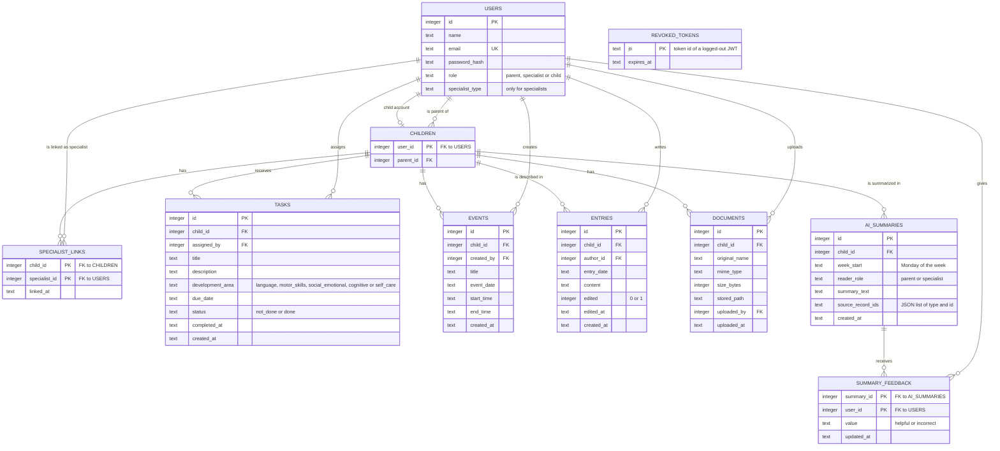

The walking skeleton already has `users`, `children`, `specialist_links` and `tasks` (`server/src/db/schema.sql`); `revoked_tokens`, `events`, `entries`, `documents`, `ai_summaries` and `summary_feedback` are added with their module (M1, M3, M5, M6, M8), and the weekly statistics (M7) are calculated from `tasks` without a table of their own.

---

## 4. API / Interfaces

| Method | Endpoint | Description | Module |
|---|---|---|---|
| GET | `/api/health` | Walking-skeleton check: the API is running and can read the database (number of users) | Skeleton |
| POST | `/api/auth/login` | Checks email and password against the bcrypt hash and returns a signed JWT (user id, role and token id `jti`) with the user's name and role; the same 401 message for an unknown email and a wrong password | M1 |
| GET | `/api/auth/me` | Returns the user of the token (id, name, role); React uses it to open the start screen of the role | M1 |
| POST | `/api/auth/logout` | Ends the session: the token's `jti` is stored as revoked; later requests with it get 401 | M1 |
| GET | `/api/children` | Parent: own children; specialist: the children currently linked to them | M2 |
| GET | `/api/children/:childId/specialists` | Linked specialists of the child with name and specialist type (parent only) | M2 |
| POST | `/api/children/:childId/specialists` | Parent links a specialist by email; error if the email is not a registered specialist; no second link for one who is already linked | M2 |
| DELETE | `/api/children/:childId/specialists/:specialistId` | Parent unlinks a specialist (React asks for confirmation first) | M2 |
| GET | `/api/children/:childId/events?week=YYYY-MM-DD` | Events of the week that starts on the given Monday, ordered by day and time | M3 |
| POST | `/api/children/:childId/events` | Parent or linked specialist adds an event (title, date, start time, end time); 400 for a missing title or date or an end time before the start time | M3 |
| GET | `/api/tasks` | Tasks the user may see, with their status: a child gets their own tasks, a parent or linked specialist gets the tasks of `?childId=` | M4 |
| POST | `/api/tasks` | Parent or linked specialist assigns a task (`childId`, `title`, `description`, `developmentArea`, `dueDate`); the status starts as `not_done`; 400 for a missing title, development area or due date | M4 |
| PATCH | `/api/tasks/:id` | The child marks their own task as done (`status: "done"`, sets `completed_at`); 403 for a task of another child | M4 |
| GET | `/api/children/:childId/entries` | Specialist entries, newest first, with author name, date and "edited" mark (parent and linked specialists only) | M5 |
| POST | `/api/children/:childId/entries` | Linked specialist adds an entry (date, text); 400 for an empty text | M5 |
| PATCH | `/api/entries/:id` | The author edits the text; sets `edited` and `edited_at`; 403 for anyone else | M5 |
| POST | `/api/children/:childId/documents` | Uploads one file as `multipart/form-data`; only PDF, JPEG or PNG up to 10 MB, otherwise 400 and nothing is stored | M6 |
| GET | `/api/children/:childId/documents` | Document list with name, type, uploader and upload date (parent and linked specialists only) | M6 |
| GET | `/api/documents/:id/file` | Sends the file to view in the browser; with `?download=1` as a download with its original name | M6 |
| GET | `/api/children/:childId/statistics?week=YYYY-MM-DD` | Completion rate of the tasks due that week, in total and per development area, or a "no tasks" result | M7 |
| GET | `/api/children/:childId/summaries?week=YYYY-MM-DD` | The reader's stored summary of that week for their role, with its source records and the reader's own feedback; empty if none | M8 |
| POST | `/api/children/:childId/summaries` | Creates the summary of the week (`week` in the body) for the reader's role from the records the reader may see; returns the text, the AI-generated label and the source records; "nothing to summarize" without an AI call for an empty week; 502 with a message when the provider fails; the provider call is aborted after 15 seconds (`AbortSignal.timeout(15000)`) and the route then answers 502 with the same error message | M8 |
| PUT | `/api/summaries/:id/feedback` | Saves the reader's choice, `helpful` or `incorrect`, and returns it | M8 |

Every endpoint except `GET /api/health` and `POST /api/auth/login` needs a valid JWT in the `Authorization: Bearer` header (401 otherwise) and passes the role and child access checks (403 otherwise, with no data about the child); JSON bodies use camelCase field names such as `childId`, `developmentArea` and `dueDate`.

---

## 5. Critical Flows

### Flow 1: Log in by role (FR-M1-01, FR-M1-04)

Given the seeded parent, specialist and child accounts, when each logs in with the correct password, then each lands on their own start screen, and opening another role's page by its address is denied.

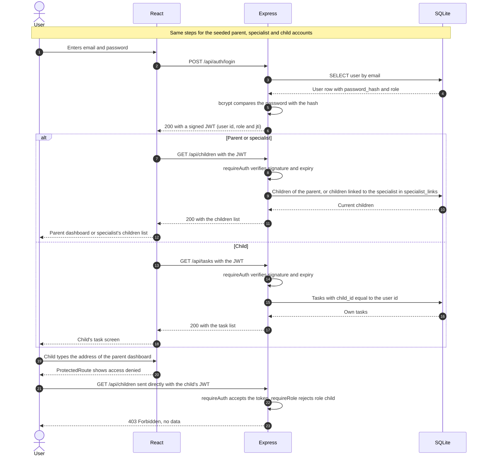

### Flow 2: Assign and complete a task (FR-M4-01, FR-M4-03, FR-M4-05)

Given a specialist linked to a child, when the specialist assigns a task and the child marks it as done, then the child sees the task in their list and the specialist sees its status as "done".

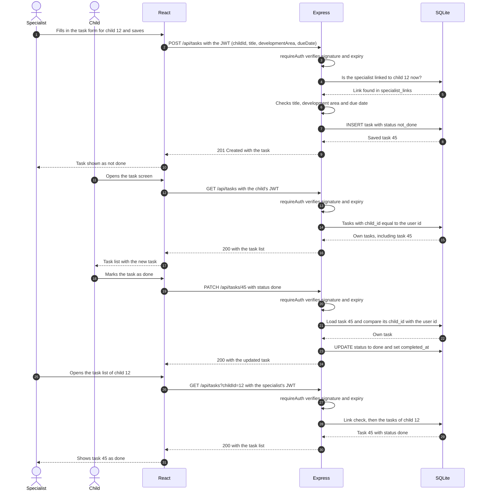

### Flow 3: Unlinked specialist is blocked (FR-M2-04, FR-M2-05)

Given a linked specialist who is logged in, when the parent unlinks the specialist and the specialist then requests the child's tasks with the same unexpired token, then the API answers 403 and returns no data about the child.

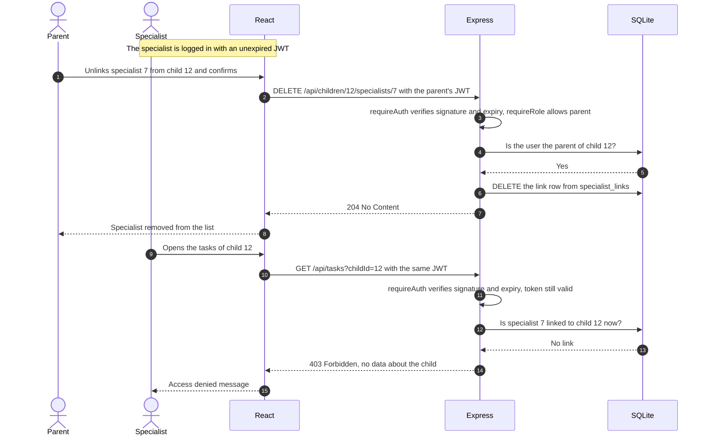

---

## 6. User Interface

| Screen | Image | Module |
|---|---|---|
| Login | 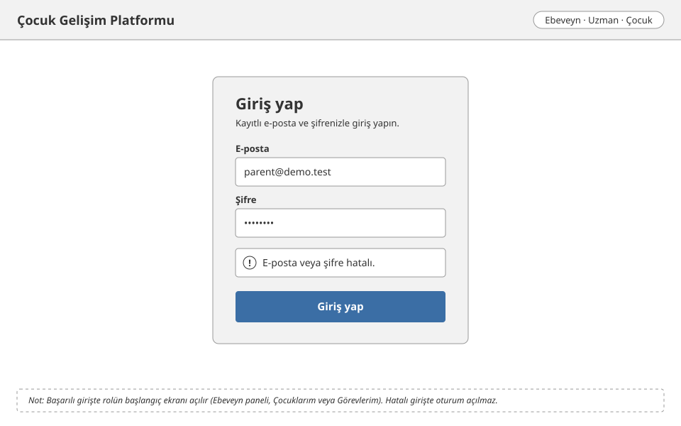 | M1 |
| Parent dashboard | 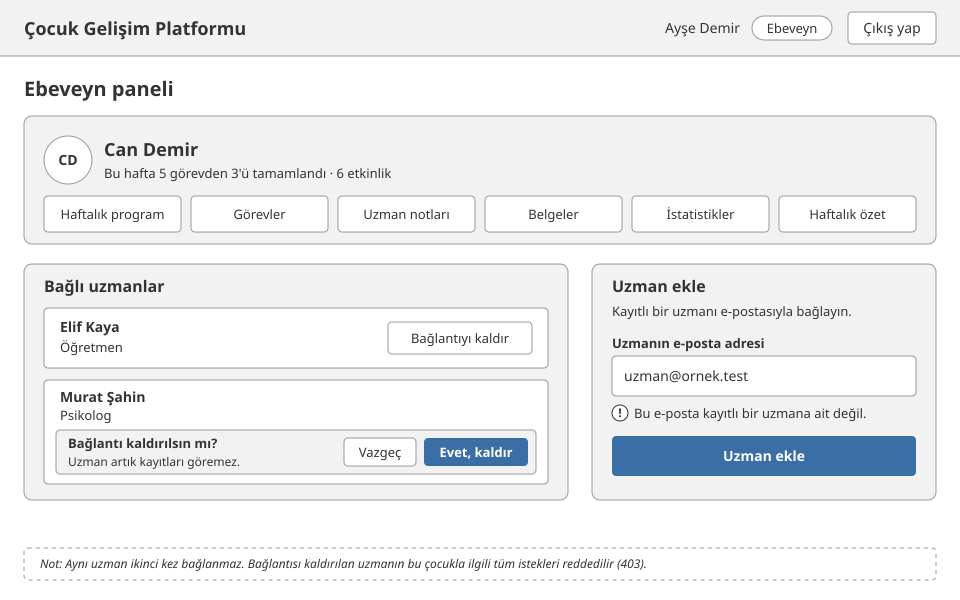 | M1, M2 |
| Specialist's children | 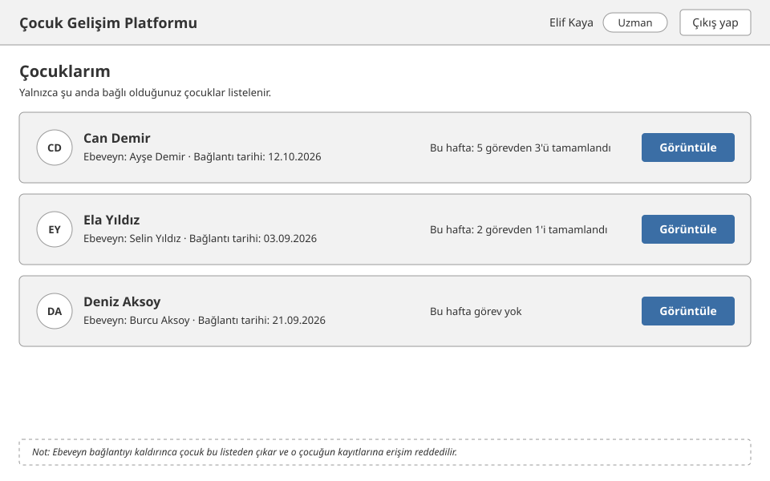 | M2 |
| Weekly schedule | 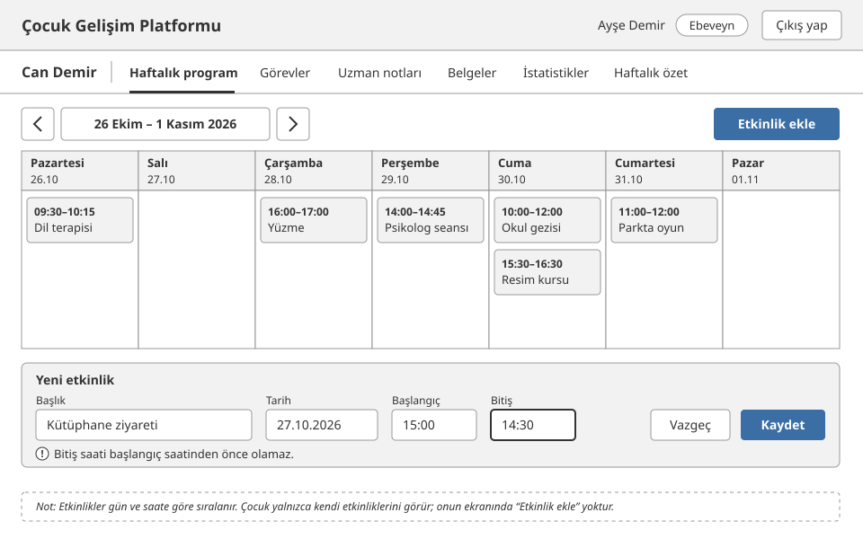 | M3 |
| Task form | 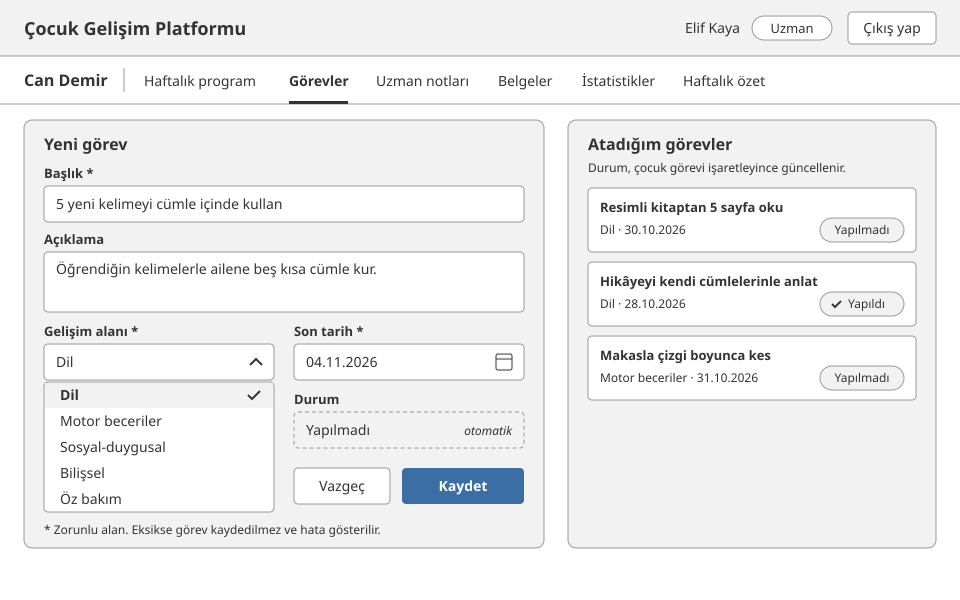 | M4 |
| Child's tasks | 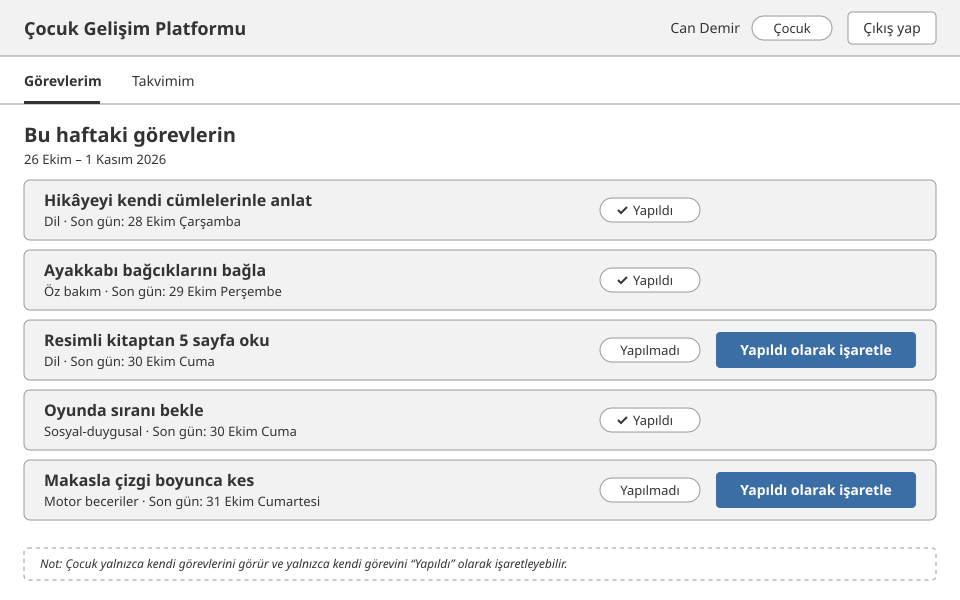 | M4 |
| Specialist entries | 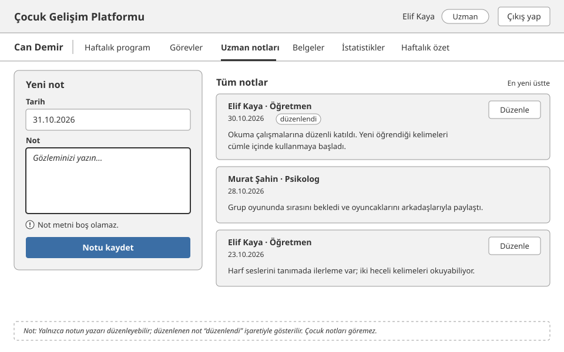 | M5 |
| Documents | 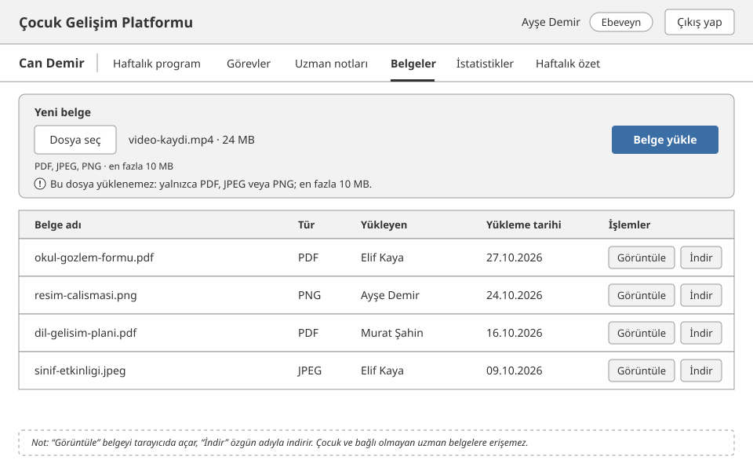 | M6 |
| Weekly statistics | 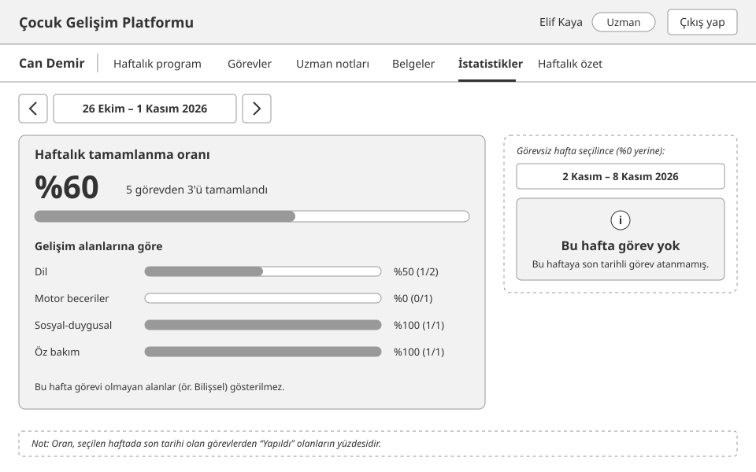 | M7 |
| AI summary | 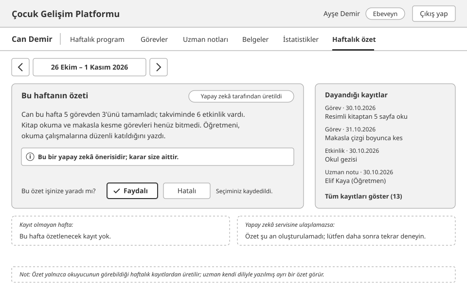 | M8 |

---

## 7. Change Log

| Date | Change | By |
|---|---|---|
| 2026-10-31 | First version | Mert Akdemir |
