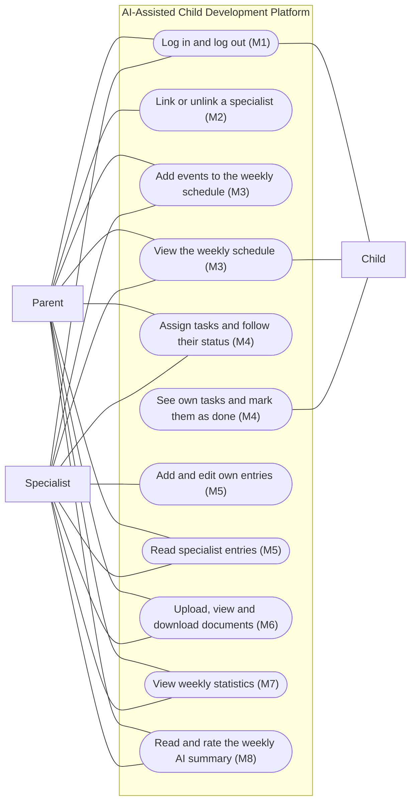

# Software Requirements Specification (SRS)

**Team name:** 383-G9 (Batın Abiş, Mert Akdemir, Burak Tunahan Mazman)  
**Version:** ☒ First version (Week 6) ☐ Final (Week 10)  
**Last updated:** 2026-10-31

---

## 1. Introduction

**Purpose of the system:**

The AI-Assisted Child Development Platform is a web application that gives a child's parent and specialists one shared weekly schedule, one task list and one record of observations, while the child sees their own schedule and tasks. An AI component summarizes each week's records for the reader's role, with one version for parents and one for specialists. The AI only supports decisions; the user always makes the decision.

**Users of the system:**

| User type | Description |
|---|---|
| Parent | Sees all records of their own child and links specialists to the child or unlinks them. |
| Specialist | Teacher, psychologist, doctor, special education teacher or coach. Works only with the children they are currently linked to. |
| Child | Sees only their own schedule and tasks, and marks their own tasks as done. |

**Access rules:**

| What | Parent | Linked specialist | Unlinked specialist | Child |
|---|---|---|---|---|
| Child's weekly schedule | View, add | View, add | No access | View own |
| Child's tasks | View, assign | View, assign | No access | View own, mark done |
| Specialist entries | View | View, add, edit own | No access | No access |
| Documents | View, upload, download | View, upload, download | No access | No access |
| Weekly statistics | View | View | No access | No access |
| AI weekly summary | View, rate (parent version) | View, rate (specialist version) | No access | No access |
| Link / unlink specialists | Yes | No | No | No |

The backend enforces these rules on every request; hiding a button in the user interface is not enough.

**Note:** Accounts are created by the seed script (there is no sign-up screen in v1.0), each child has exactly one parent account, and only synthetic data is used. The interface text is in Turkish, and a week runs from Monday 00:00 to Sunday 23:59 (local time). A record is a schedule event, task, specialist entry or document of the child. Quoted labels such as "done", "not done", "edited", "AI-generated", "helpful" and "incorrect" stand for their Turkish interface text; only the note in FR-M8-05 is quoted word for word.

---

## 2. Functional Requirements

When a requirement says that the system rejects a request or denies access, the API answers 401 if the user is not logged in and 403 if the user is not allowed, and returns no data about the child.

### M1 – Login and roles

| ID | Requirement | Priority |
|---|---|---|
| FR-M1-01 | The system shall let a registered user log in with email and password and open the start screen of the user's role: the parent dashboard, the specialist's list of children or the child's task screen. | Must |
| FR-M1-02 | The system shall show one error message for a wrong password or an unknown email, without saying which of the two was wrong, and shall not start a session. | Must |
| FR-M1-03 | The system shall let a logged-in user log out; after that, protected pages and API endpoints shall require a new login. | Must |
| FR-M1-04 | The system shall deny a user access to the pages and API endpoints of other roles, also when the page address is typed directly (API status 403). | Must |
| FR-M1-05 | The system shall reject every call to a protected API endpoint without a valid token with status 401. | Must |

### M2 – Linking specialists

| ID | Requirement | Priority |
|---|---|---|
| FR-M2-01 | The system shall let a parent link a registered specialist to their child by entering the specialist's email; the specialist then appears in the child's list of linked specialists with name and specialist type. | Must |
| FR-M2-02 | The system shall show an error and link no one when the email does not belong to a registered specialist. | Must |
| FR-M2-03 | The system shall not create a second link when the parent links a specialist who is already linked to the child. | Must |
| FR-M2-04 | The system shall let a parent unlink a specialist from their child after a confirmation step. | Must |
| FR-M2-05 | The system shall reject every request of an unlinked specialist about the child (schedule, tasks, entries, documents, statistics, AI summary), even when the specialist's token has not expired. | Must |
| FR-M2-06 | The system shall show a specialist exactly the children they are currently linked to. | Must |

### M3 – Weekly schedule

| ID | Requirement | Priority |
|---|---|---|
| FR-M3-01 | The system shall let a parent or linked specialist add an event with title, date, start time and end time to the child's schedule. | Must |
| FR-M3-02 | The system shall reject an event with a missing title or date, or with an end time before its start time, and show an error. | Must |
| FR-M3-03 | The system shall show the events of a selected week (Monday to Sunday), ordered by day and time. | Must |
| FR-M3-04 | The system shall show a child only their own events and give the child no option to add events. | Must |
| FR-M3-05 | The system shall offer a monthly view of the schedule. | Could |

### M4 – Tasks

| ID | Requirement | Priority |
|---|---|---|
| FR-M4-01 | The system shall let a parent or linked specialist assign a task to the child with title, description, development area (Language, Motor skills, Social-emotional, Cognitive or Self-care) and due date; a new task has the status "not done". | Must |
| FR-M4-02 | The system shall reject a task with a missing title, development area or due date and show an error. | Must |
| FR-M4-03 | The system shall let a child mark their own task as done, which changes its status to "done". | Must |
| FR-M4-04 | The system shall reject a child's request to change a task of another child. | Must |
| FR-M4-05 | The system shall show the user who assigned tasks the current status ("done" / "not done") of each of those tasks. | Must |
| FR-M4-06 | The system shall support recurring tasks (for example every weekday). | Could |
| FR-M4-07 | The system shall notify the child when a new task is assigned. | Could |

### M5 – Specialist entries

| ID | Requirement | Priority |
|---|---|---|
| FR-M5-01 | The system shall let a linked specialist add a dated entry (date and text) about the child; the entry shows the author's name and the date. | Must |
| FR-M5-02 | The system shall reject an entry with empty text and show an error. | Must |
| FR-M5-03 | The system shall let the author of an entry edit it; the entry then shows the new text and the mark "edited". | Must |
| FR-M5-04 | The system shall reject an attempt to edit an entry written by another specialist. | Must |
| FR-M5-05 | The system shall show the parent and every linked specialist all entries about the child, newest first. | Must |
| FR-M5-06 | The system shall deny a child access to specialist entries, in the user interface and in the API. | Must |
| FR-M5-07 | The system shall keep and show the earlier versions of an edited entry. | Could |

### M6 – Documents

| ID | Requirement | Priority |
|---|---|---|
| FR-M6-01 | The system shall let a parent or linked specialist upload a PDF, JPEG or PNG file of at most 10 MB; the document list shows its name, type, uploader and upload date. | Must |
| FR-M6-02 | The system shall reject a file of another type or larger than 10 MB, show an error and not store the file. | Must |
| FR-M6-03 | The system shall let a parent or linked specialist view a document in the browser and download it with its original name. | Must |
| FR-M6-04 | The system shall deny a child and an unlinked specialist access to the document list and to document files. | Must |
| FR-M6-05 | The system shall let the uploader share a document with only some of the linked specialists. | Could |

### M7 – Weekly statistics

| ID | Requirement | Priority |
|---|---|---|
| FR-M7-01 | The system shall show, for a selected week, the child's task completion rate as the percentage of the tasks due that week that are done. | Must |
| FR-M7-02 | The system shall show a separate completion rate for each development area that has tasks due in the selected week. | Must |
| FR-M7-03 | The system shall show a message that there are no tasks, instead of 0 %, for a week without tasks. | Must |

### M8 – Role-based AI summary

| ID | Requirement | Priority |
|---|---|---|
| FR-M8-01 | The system shall give a parent an AI summary of the child's week, written in plain language for parents. | Must |
| FR-M8-02 | The system shall give a linked specialist an AI summary of the child's week written for specialists, using a different prompt than the parent version. | Must |
| FR-M8-03 | The system shall build the summary prompt only from the week's records that the reader is allowed to see. | Must |
| FR-M8-04 | The system shall label each summary "AI-generated" and list the records it is based on, each with a link to the record. | Must |
| FR-M8-05 | The system shall always add to the prompt the fixed instruction not to give a diagnosis, not to suggest a treatment and not to make decisions, and shall show the note "Bu bir yapay zekâ önerisidir; karar size aittir." with every summary. | Must |
| FR-M8-06 | The system shall say that there is nothing to summarize, without calling the AI provider, for a week without records. | Must |
| FR-M8-07 | The system shall show a clear error message when the AI provider is unreachable or returns an error, while the rest of the page keeps working. | Must |
| FR-M8-08 | The system shall, in mock mode (tests and CI), return a fixed summary text for each reader role without any network call. | Must |
| FR-M8-09 | The system shall let the reader mark a summary as "helpful" or "incorrect", save the choice and show it as selected. | Must |

### Jira Tasks and Sprints

Each Jira story under the module epics M1–M8 implements a group of requirements. Assignees and sprints are as in Jira on 31 October 2026 (Sprint 2 = weeks 6–7, Sprint 3 = week 8, Sprint 4 = weeks 9–10; see `docs/PMP.md`).

| Requirements | Jira task | Assignee | Sprint | Release |
|---|---|---|---|---|
| FR-M1-01 … FR-M1-03 | TF383-37 – Log in and log out | Mert Akdemir | Sprint 2 | v0.1 |
| FR-M1-04, FR-M1-05 | TF383-38 – Role-based access to pages and API | Mert Akdemir | Sprint 2 | v0.1 |
| FR-M2-01 … FR-M2-03 | TF383-39 – Link a specialist by email | Mert Akdemir | Sprint 2 | v0.1 |
| FR-M2-04, FR-M2-05 | TF383-40 – Unlink a specialist | Mert Akdemir | Sprint 2 | v0.1 |
| FR-M2-06 | TF383-41 – Specialist sees linked children | Mert Akdemir | Sprint 2 | v0.1 |
| FR-M3-01, FR-M3-02 | TF383-42 – Add an event to the schedule | Batın Abiş | Sprint 2 | v0.1 |
| FR-M3-03, FR-M3-04 | TF383-43 – Weekly schedule view | Batın Abiş | Sprint 2 | v0.1 |
| FR-M4-01, FR-M4-02 | TF383-44 – Assign a task | Mert Akdemir | Sprint 3 | v0.1 |
| FR-M4-03, FR-M4-04 | TF383-45 – Child marks a task done | Mert Akdemir | Sprint 3 | v0.1 |
| FR-M4-05 | TF383-46 – Assigner sees task status | Batın Abiş | Sprint 3 | v0.1 |
| FR-M5-01, FR-M5-02 | TF383-47 – Add a dated entry | Batın Abiş | Sprint 4 | v0.2 |
| FR-M5-03, FR-M5-04 | TF383-48 – Edit own entry | Batın Abiş | Sprint 4 | v0.2 |
| FR-M5-05, FR-M5-06 | TF383-49 – Read entries, hidden from the child | Batın Abiş | Sprint 4 | v0.2 |
| FR-M6-01, FR-M6-02 | TF383-50 – Upload a PDF or image | Batın Abiş | Sprint 2 | v0.2 |
| FR-M6-03, FR-M6-04 | TF383-51 – View and download documents | Batın Abiş | Sprint 2 | v0.2 |
| FR-M7-01 … FR-M7-03 | TF383-52 – Weekly completion rate, total and by area | Batın Abiş | Sprint 4 | v0.2 |
| FR-M8-01 … FR-M8-08 | TF383-53 – Role-based weekly AI summary | Mert Akdemir | Sprint 4 | v0.2 |
| FR-M8-09 | TF383-54 – Helpful / incorrect feedback on a summary | Mert Akdemir | Sprint 4 | v0.2 |

The Could requirements (FR-M3-05, FR-M4-06, FR-M4-07, FR-M5-07, FR-M6-05) have no Jira task yet; they get one only if time allows after v1.0 scope is done.

---

## 3. Non-Functional Requirements

| ID | Category | Requirement |
|---|---|---|
| NFR-01 | Security | Passwords are stored only as bcrypt hashes; the database holds no plain-text password. |
| NFR-02 | Security | Every API request about a child is checked against the current parent or specialist link in the database, not only against the token; an unlinked specialist with an unexpired token gets 403. |
| NFR-03 | Privacy | The JWT secret and the AI provider key are read only from the backend's `.env` file and are never in frontend code or in the repository; only synthetic seed data is used. |
| NFR-04 | Performance | With the seed data, every page loads in under 2 seconds on a normal laptop; a live AI summary appears within 15 seconds or an error message is shown. |
| NFR-05 | Maintainability | CI runs the backend, frontend and end-to-end tests on every pull request; branch coverage is at least 40 % at v0.2 and at least 60 % at v1.0. |

---

## 4. Critical Flows and Acceptance Criteria

| Flow | Related requirements | Acceptance criteria |
|---|---|---|
| Flow 1: Log in by role | FR-M1-01, FR-M1-04 | **Given** the seeded parent, specialist and child accounts, **When** each logs in with the correct password, **Then** each lands on their own start screen, and opening another role's page by its address is denied. |
| Flow 2: Assign and complete a task | FR-M4-01, FR-M4-03, FR-M4-05 | **Given** a specialist linked to a child, **When** the specialist assigns a task and the child marks it as done, **Then** the child sees the task in their list and the specialist sees its status as "done". |
| Flow 3: Unlinked specialist is blocked | FR-M2-04, FR-M2-05 | **Given** a linked specialist who is logged in, **When** the parent unlinks the specialist and the specialist then requests the child's tasks with the same unexpired token, **Then** the API answers 403 and returns no data about the child. |

---

## 5. Use Case Diagram (optional)

In the diagram, "Specialist" means a specialist who is linked to the child (M2).

---

## 6. Change Log

| Date | Change | By |
|---|---|---|
| 2026-10-25 | First draft with user stories US-1.1 … US-8.3 | 383-G9 |
| 2026-10-31 | Rewritten in the course template: FR-M1-01 … FR-M8-09 replace user stories US-1.1 … US-8.3; NFR-01 … NFR-05 replace NFR-1 … NFR-9; three critical flows added; optional extensions kept as Could requirements; AI task suggestions dropped because the AI only summarizes records; Jira tasks and sprints table added | Mert Akdemir |
